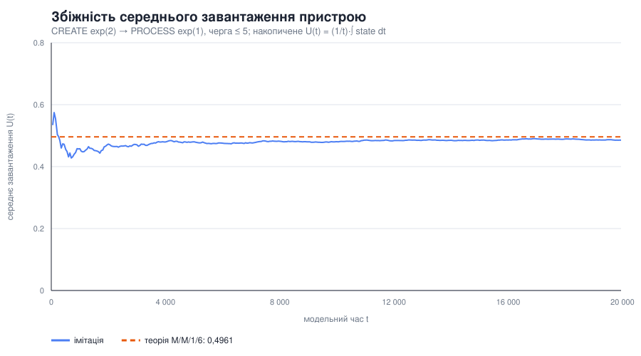
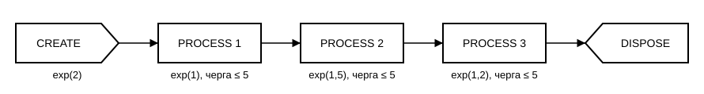
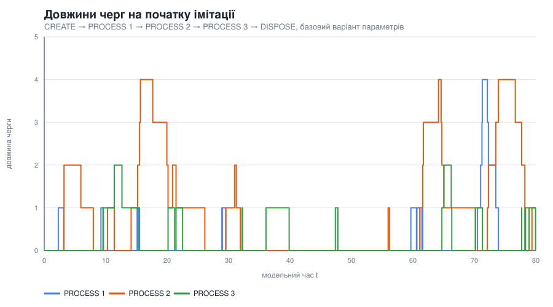
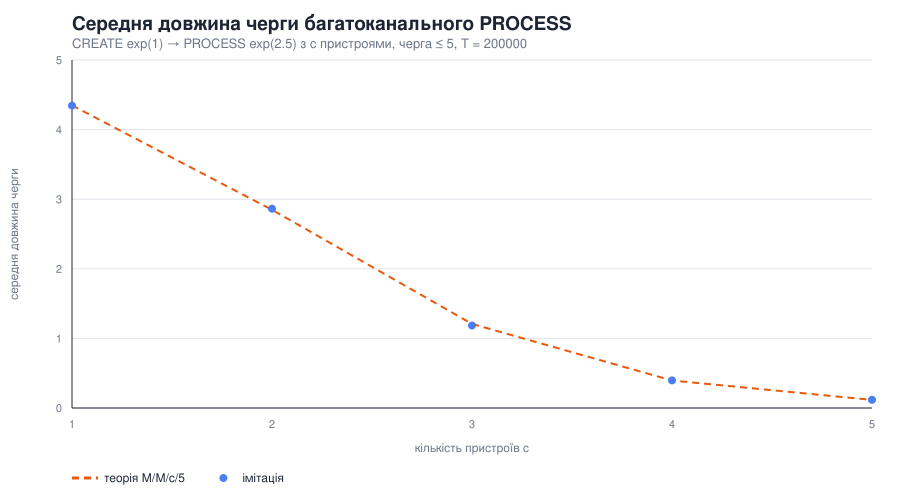
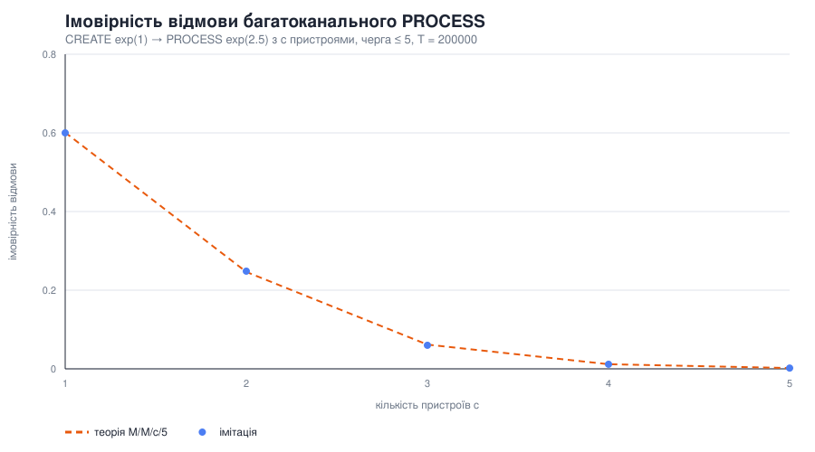
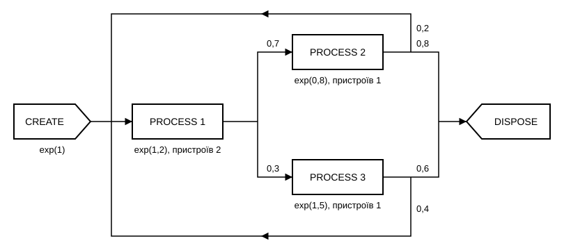

# Комп’ютерний практикум №2
## «Об’єктно-орієнтований підхід до побудови імітаційних моделей дискретно-подійних систем»

**Дата виконання:** 21.10.2026  
**Середовище:** Bun 1.4.2 / darwin arm64  
**Мова реалізації:** TypeScript (без сторонніх бібліотек; генератор випадкових чисел з початковим значенням — результати відтворювані)

### Мета роботи
Реалізувати алгоритм імітації дискретно-подійної системи за принципом найближчої події з використанням об’єктно-орієнтованого підходу, побудувати модель із трьох послідовних процесів обслуговування, розширити клас PROCESS багатоканальним обслуговуванням і маршрутизацією в кілька блоків та виконати верифікацію моделі.

### Структура програми

| Клас / модуль | Призначення |
| --- | --- |
| `Element` (`element.ts`) | базовий елемент: `tnext`, `tcurr`, `quantity`, маршрут `next`, методи `inAct`, `outAct`, `doStatistics` |
| `Create` (`create.ts`) | джерело вимог: у момент `tnext` створює вимогу й планує наступне надходження |
| `Process` (`process.ts`) | обслуговування c ідентичними пристроями зі спільною обмеженою чергою, накопичення статистики |
| `Dispose` (`dispose.ts`) | вихід із моделі, час перебування вимог у системі |
| `Router`, `to`, `branch` | маршрут вимоги: одна гілка (аналог `nextElement`) або кілька гілок з імовірностями |
| `Model` (`model.ts`) | алгоритм імітації за принципом найближчої події |
| `random.ts` | аналог `FunRand`: експоненційний, рівномірний, нормальний, Ерланга та сталий закони |
| `theory.ts` | формули M/M/c/K та рівняння балансу потоків мережі — еталон для верифікації |

Діаграма класів відповідає рисунку 2.5 методички: `Create`, `Process` і `Dispose` успадковують `Element`, `Model` агрегує список елементів. Поле `nextElement` замінено інтерфейсом `Router` — це й дає змогу в завданні 6 організувати вихід у кілька блоків без зміни решти коду.

---

## 1. Алгоритм імітації моделі обслуговування одним пристроєм (ООП)

Модель CREATE → PROCESS → DISPOSE (рисунок 2.4): інтервал між надходженнями — exp(2), час обслуговування — exp(1), максимальна довжина черги 5, час моделювання 1000.

Крок алгоритму `Model.simulate`:
1. знайти найменший `tnext` серед усіх елементів (момент найближчої події);
2. для всіх елементів накопичити статистику `doStatistics(tnext − tcurr)` — стан між подіями не змінюється;
3. просунути модельний час `tcurr = tnext` у всіх елементах;
4. виконати `outAct()` усіх елементів, у яких `tnext = tcurr` (одночасні події обробляються за один крок).

```ts
for (;;) {
  let tnext = Infinity;
  for (const e of this.elements) tnext = Math.min(tnext, e.tnext);
  const until = Math.min(tnext, time);
  for (const e of this.elements) e.doStatistics(until - this.tcurr);
  this.tcurr = until;
  for (const e of this.elements) e.tcurr = until;
  if (tnext > time) return this;
  const fired = this.elements.filter((e) => e.tnext === this.tcurr);
  for (const e of fired) e.outAct();
}
```

На відміну від лістингу з методички, останній крок не виходить за межу `time`: статистика накопичується точно до кінця інтервалу моделювання, тож середні за часом величини діляться на правильну тривалість.

**Трасування перших кроків імітації** (аналог виводу `printInfo`):

| Крок | t | Подія | Створено | Стан пристрою | Черга | Обслуговано | Відмови |
| ---: | ---: | --- | ---: | ---: | ---: | ---: | ---: |
| 1 | 0,000 | CREATOR | 1 | 1 | 0 | 0 | 0 |
| 2 | 1,844 | PROCESSOR | 1 | 0 | 0 | 1 | 0 |
| 3 | 2,280 | CREATOR | 2 | 1 | 0 | 1 | 0 |
| 4 | 2,286 | PROCESSOR | 2 | 0 | 0 | 2 | 0 |
| 5 | 7,771 | CREATOR | 3 | 1 | 0 | 2 | 0 |
| 6 | 9,594 | CREATOR | 4 | 1 | 1 | 2 | 0 |
| 7 | 9,643 | CREATOR | 5 | 1 | 2 | 2 | 0 |
| 8 | 10,597 | PROCESSOR | 5 | 1 | 1 | 3 | 0 |
| 9 | 10,789 | PROCESSOR | 5 | 1 | 0 | 4 | 0 |
| 10 | 11,433 | PROCESSOR | 5 | 0 | 0 | 5 | 0 |
| 11 | 12,347 | CREATOR | 6 | 1 | 0 | 5 | 0 |
| 12 | 13,395 | PROCESSOR | 6 | 0 | 0 | 6 | 0 |
| 13 | 15,730 | CREATOR | 7 | 1 | 0 | 6 | 0 |
| 14 | 17,992 | PROCESSOR | 7 | 0 | 0 | 7 | 0 |

**Результати за T = 1 000** (981 кроків імітації):

| Показник | Значення |
| --- | ---: |
| Створено вимог (CREATOR quantity) | 491 |
| Обслуговано вимог (PROCESSOR quantity) | 490 |
| Кількість відмов | 1 |
| Імовірність відмови | 0,0020 |
| Середня довжина черги | 0,361 |
| Середній час очікування в черзі | 0,738 |

Імовірність відмови рахується як відношення кількості відмов до кількості вимог, що *надійшли* в PROCESS (у методичці — до кількості обслугованих, що дає трохи завищену оцінку).

---

## 2. Середнє завантаження пристрою

Завантаження — частка часу, протягом якої пристрій зайнятий. Метод `doStatistics(delta)` класу `Process` накопичує інтеграл кількості зайнятих пристроїв `busyArea += busy·delta` поряд з інтегралом довжини черги; середнє завантаження U = busyArea / (T·c).

```ts
override doStatistics(delta: number): void {
  this.queueArea += this.#queue.length * delta;
  this.busyArea += this.#busy.length * delta;
}
```

Для перевірки використано точні формули СМО M/M/1/6 (ρ = 0,5): U = ρ·(1 − P_відм) = 0,4961, L_черги = 0,4488, P_відм = 0,0079.

| Час моделювання T | Створено | U (імітація) | U (теорія) | Відхилення U | L_черги | P_відм |
| ---: | ---: | ---: | ---: | ---: | ---: | ---: |
| 1 000 | 491 | 0,4895 | 0,4961 | 1,33 % | 0,3615 | 0,0020 |
| 10 000 | 4 928 | 0,4812 | 0,4961 | 3,00 % | 0,3801 | 0,0053 |
| 100 000 | 49 918 | 0,4940 | 0,4961 | 0,41 % | 0,4446 | 0,0078 |
| 1 000 000 | 500 519 | 0,4965 | 0,4961 | 0,09 % | 0,4491 | 0,0076 |



Зі збільшенням часу моделювання оцінка завантаження збігається до теоретичного значення: при T = 1000 відхилення становить 1,33 %, при T = 10⁶ — 0,09 %.

---

## 3. Модель із трьох послідовних процесів (рисунок 2.1)

CREATE → PROCESS 1 → PROCESS 2 → PROCESS 3 → DISPOSE. Кожен елемент з’єднується з наступним маршрутом `to(next)`; вимога, що отримала відмову в будь-якому процесі, з моделі видаляється.



| Параметр | Значення |
| --- | --- |
| Інтервал між надходженнями | exp(2) |
| PROCESS 1 | exp(1), черга ≤ 5, пристроїв 1 |
| PROCESS 2 | exp(1.5), черга ≤ 5, пристроїв 1 |
| PROCESS 3 | exp(1.2), черга ≤ 5, пристроїв 1 |
| Час моделювання | 100 000 |

| Елемент | Надійшло | Обслуговано | Відмови | P_відм | L_черги | U | Очікування в черзі |
| --- | ---: | ---: | ---: | ---: | ---: | ---: | ---: |
| PROCESS 1 | 50 255 | 49 866 | 388 | 0,0077 | 0,449 | 0,496 | 0,900 |
| PROCESS 2 | 49 866 | 47 505 | 2 360 | 0,0473 | 1,202 | 0,711 | 2,530 |
| PROCESS 3 | 47 505 | 46 990 | 510 | 0,0107 | 0,604 | 0,564 | 1,286 |

Створено 50 255 вимог, вийшло з моделі (DISPOSE) 46 990, середній час перебування в системі 8,440. Баланс вимог: 50 255 = 46 990 (вийшли) + 3 258 (відмови) + 7 (у моделі на момент T) — виконується.



Вузьке місце — PROCESS 2 з найбільшим середнім часом обслуговування: у ньому найдовша черга й найбільша частка відмов. Потік на вході PROCESS 2 і PROCESS 3 «проріджений» відмовами попередніх процесів, тому кількість надходжень спадає вздовж ланцюга.

---

## 4. Верифікація моделі

Верифікацію виконано трьома способами:
1. **Зміна вхідних змінних і параметрів** — для кожного варіанта заздалегідь сформульовано очікуваний напрямок зміни вихідних величин відносно базового варіанта; програма перевіряє його автоматично.
2. **Порівняння з аналітичним розв’язком** — на вхід PROCESS 1 завжди надходить пуассонівський потік, тому для експоненційних законів його характеристики точно описуються формулами M/M/1/K.
3. **Необмежені черги** — за теоремою Берка вихідний потік M/M/1 пуассонівський, тож увесь ланцюг є мережею Джексона і кожен процес має характеристики M/M/1 з тим самим λ.

Позначення: tc — середній інтервал надходження, t_i — середній час обслуговування в PROCESS i, P_i — імовірність відмови, L_i — середня довжина черги, U_i — завантаження, W — середній час перебування в системі. Час моделювання кожного варіанта T = 100 000.

**Таблиця 4.1 — Результати верифікації**

| № | Варіант | Зміна | P1 | P2 | P3 | L1 | L2 | L3 | U1 | U2 | U3 | W |
| ---: | --- | --- | ---: | ---: | ---: | ---: | ---: | ---: | ---: | ---: | ---: | ---: |
| 1 | Базовий | tc = 2; t1 = 1; t2 = 1,5; t3 = 1,2; черги ≤ 5 | 0,0077 | 0,0473 | 0,0107 | 0,449 | 1,202 | 0,604 | 0,496 | 0,711 | 0,564 | 8,440 |
| 2 | Інтенсивніший потік | tc = 1 | 0,1432 | 0,2604 | 0,0458 | 2,165 | 3,080 | 1,255 | 0,862 | 0,949 | 0,726 | 13,584 |
| 3 | Рідший потік | tc = 4 | 0,0002 | 0,0015 | 0,0006 | 0,091 | 0,216 | 0,129 | 0,254 | 0,376 | 0,301 | 5,438 |
| 4 | Повільніший PROCESS 1 | t1 = 2 | 0,1444 | 0,0192 | 0,0045 | 2,119 | 0,837 | 0,435 | 0,857 | 0,635 | 0,502 | 12,717 |
| 5 | Повільніший PROCESS 2 | t2 = 3 | 0,0093 | 0,3465 | 0,0009 | 0,454 | 3,456 | 0,224 | 0,494 | 0,969 | 0,387 | 17,485 |
| 6 | Швидший PROCESS 3 | t3 = 0,6 | 0,0081 | 0,0486 | 0,0002 | 0,443 | 1,220 | 0,110 | 0,496 | 0,716 | 0,285 | 6,799 |
| 7 | Без черг | черги = 0 | 0,3322 | 0,2576 | 0,1254 | 0,000 | 0,000 | 0,000 | 0,331 | 0,370 | 0,257 | 3,988 |
| 8 | Короткі черги | черги ≤ 1 | 0,1412 | 0,1711 | 0,0736 | 0,142 | 0,209 | 0,113 | 0,428 | 0,532 | 0,398 | 5,144 |
| 9 | Необмежені черги | черги = ∞ | 0,0000 | 0,0000 | 0,0000 | 0,523 | 2,376 | 0,893 | 0,501 | 0,756 | 0,601 | 11,233 |
| 10 | Детерміновані затримки | усі затримки сталі | 0,0000 | 0,0000 | 0,0000 | 0,000 | 0,000 | 0,000 | 0,500 | 0,750 | 0,600 | 3,700 |
| 11 | Рівномірні затримки | unif з тими самими середніми | 0,0000 | 0,0000 | 0,0000 | 0,006 | 0,131 | 0,034 | 0,500 | 0,750 | 0,601 | 4,047 |
| 12 | Затримки Ерланга | erlang k = 4 з тими самими середніми | 0,0000 | 0,0006 | 0,0000 | 0,064 | 0,471 | 0,161 | 0,497 | 0,748 | 0,596 | 5,094 |
| 13 | Два пристрої в PROCESS 2 | c2 = 2 | 0,0071 | 0,0005 | 0,0182 | 0,437 | 0,109 | 0,704 | 0,493 | 0,370 | 0,586 | 6,236 |

**Таблиця 4.2 — Очікувані зміни відносно базового варіанта**

| № | Варіант | Очікувалось | Результат |
| ---: | --- | --- | --- |
| 2 | Інтенсивніший потік | U1 ↑; P_відм1 ↑; U2 ↑; P_відм2 ↑; U3 ↑; P_відм3 ↑ | ✅ усі підтверджено |
| 3 | Рідший потік | U1 ↓; L_черги1 ↓; U2 ↓; L_черги2 ↓; U3 ↓; L_черги3 ↓ | ✅ усі підтверджено |
| 4 | Повільніший PROCESS 1 | U1 ↑; P_відм1 ↑; U2 ↓; U3 ↓ | ✅ усі підтверджено |
| 5 | Повільніший PROCESS 2 | L_черги2 ↑; P_відм2 ↑; U3 ↓ | ✅ усі підтверджено |
| 6 | Швидший PROCESS 3 | U3 ↓; L_черги3 ↓; W ↓ | ✅ усі підтверджено |
| 7 | Без черг | L_черги1 = 0; L_черги2 = 0; L_черги3 = 0; P_відм1 ↑; P_відм2 ↑; P_відм3 ↑ | ✅ усі підтверджено |
| 8 | Короткі черги | P_відм1 ↑; L_черги1 ≤ 1; P_відм2 ↑; L_черги2 ≤ 1; P_відм3 ↑; L_черги3 ≤ 1 | ✅ усі підтверджено |
| 9 | Необмежені черги | P_відм1 = 0; P_відм2 = 0; P_відм3 = 0; L_черги1 ↑; L_черги2 ↑; L_черги3 ↑ | ✅ усі підтверджено |
| 10 | Детерміновані затримки | L_черги1 = 0; L_черги2 = 0; L_черги3 = 0; P_відм1 = 0; P_відм2 = 0; P_відм3 = 0; U1 = 0,5; U2 = 0,75; U3 = 0,6 | ✅ усі підтверджено |
| 11 | Рівномірні затримки | L_черги1 ↓; L_черги2 ↓; L_черги3 ↓ | ✅ усі підтверджено |
| 12 | Затримки Ерланга | L_черги1 ↓; L_черги2 ↓; L_черги3 ↓ | ✅ усі підтверджено |
| 13 | Два пристрої в PROCESS 2 | L_черги2 ↓; P_відм2 ↓; U3 ↑ | ✅ усі підтверджено |

**Таблиця 4.3 — PROCESS 1: імітація проти формул M/M/1/K**

| № | Варіант | P1 імітація | P1 теорія | L1 імітація | L1 теорія | U1 імітація | U1 теорія |
| ---: | --- | ---: | ---: | ---: | ---: | ---: | ---: |
| 1 | Базовий | 0,0077 | 0,0079 | 0,449 | 0,449 | 0,496 | 0,496 |
| 2 | Інтенсивніший потік | 0,1432 | 0,1429 | 2,165 | 2,143 | 0,862 | 0,857 |
| 3 | Рідший потік | 0,0002 | 0,0002 | 0,091 | 0,083 | 0,254 | 0,250 |
| 4 | Повільніший PROCESS 1 | 0,1444 | 0,1429 | 2,119 | 2,143 | 0,857 | 0,857 |
| 5 | Повільніший PROCESS 2 | 0,0093 | 0,0079 | 0,454 | 0,449 | 0,494 | 0,496 |
| 6 | Швидший PROCESS 3 | 0,0081 | 0,0079 | 0,443 | 0,449 | 0,496 | 0,496 |
| 7 | Без черг | 0,3322 | 0,3333 | 0,000 | 0,000 | 0,331 | 0,333 |
| 8 | Короткі черги | 0,1412 | 0,1429 | 0,142 | 0,143 | 0,428 | 0,429 |
| 9 | Необмежені черги | 0,0000 | 0,0000 | 0,523 | 0,500 | 0,501 | 0,500 |
| 13 | Два пристрої в PROCESS 2 | 0,0071 | 0,0079 | 0,437 | 0,449 | 0,493 | 0,496 |

**Таблиця 4.4 — Необмежені черги: імітація (T = 1 000 000) проти мережі Джексона**

| Процес | L імітація | L теорія | Відхилення | U імітація | U теорія | Очікування імітація | Очікування теорія |
| --- | ---: | ---: | ---: | ---: | ---: | ---: | ---: |
| PROCESS 1 | 0,501 | 0,500 | 0,15 % | 0,501 | 0,500 | 1,001 | 1,000 |
| PROCESS 2 | 2,269 | 2,250 | 0,85 % | 0,750 | 0,750 | 4,537 | 4,500 |
| PROCESS 3 | 0,901 | 0,900 | 0,09 % | 0,600 | 0,600 | 1,801 | 1,800 |

Середній час перебування в системі: імітація 11,040, теорія 11,000 (відхилення 0,36 %).

**Висновки з верифікації.** Усі очікувані напрямки змін підтвердились. Детерміновані затримки дають точні значення (черг і відмов немає, U_i = t_i / tc). Зменшення дисперсії часу обслуговування за незмінних середніх (рівномірний закон, закон Ерланга) зменшує черги — відома властивість СМО (формула Поллачека — Хінчина). Для PROCESS 1 і для мережі з необмеженими чергами імітація збігається з аналітичними формулами в межах статистичної похибки, отже модель адекватна.

---

## 5. PROCESS з кількома ідентичними пристроями

Клас `Process` зберігає масив зайнятих каналів (кожен — вимога та момент завершення обслуговування) і спільну чергу. `tnext` процесу — найменший момент завершення серед каналів. У `outAct()` звільняються всі канали, що завершили обслуговування в поточний момент, вільні канали забирають вимоги з черги, а обслуговані вимоги передаються далі за маршрутом.

```ts
override inAct(job: Job): void {
  this.arrivals++;
  if (this.#busy.length < this.channels) this.#start(job);
  else if (this.#queue.length < this.maxQueue) this.#queue.push({ job, since: this.tcurr });
  else this.failures++;
}

override outAct(): void {
  const done = this.#busy.filter((c) => c.tnext <= this.tcurr);
  this.#busy = this.#busy.filter((c) => c.tnext > this.tcurr);
  this.quantity += done.length;
  while (this.#busy.length < this.channels) {
    const w = this.#queue.shift();
    if (!w) break;
    this.waitTotal += this.tcurr - w.since;
    this.#start(w.job);
  }
  this.#refreshTnext();
  for (const c of done) this.send(c.job);
}
```

Перевірка: CREATE exp(1) → PROCESS exp(2.5) з c пристроями → DISPOSE, T = 200 000; навантаження a = λ/μ = 2,5. Теоретичні значення — формули M/M/c/K.

| c | Черга | P_відм імітація | P_відм теорія | L_черги імітація | L_черги теорія | Зайнято пристроїв імітація | Зайнято пристроїв теорія | Очікування імітація | Очікування теорія |
| ---: | ---: | ---: | ---: | ---: | ---: | ---: | ---: | ---: | ---: |
| 1 | 5 | 0,6000 | 0,6010 | 4,345 | 4,347 | 0,997 | 0,998 | 10,842 | 10,895 |
| 2 | 5 | 0,2484 | 0,2465 | 2,864 | 2,848 | 1,887 | 1,884 | 3,801 | 3,780 |
| 3 | 5 | 0,0599 | 0,0615 | 1,185 | 1,208 | 2,337 | 2,346 | 1,263 | 1,288 |
| 4 | 5 | 0,0116 | 0,0117 | 0,396 | 0,394 | 2,472 | 2,471 | 0,400 | 0,399 |
| 5 | 5 | 0,0019 | 0,0020 | 0,118 | 0,116 | 2,499 | 2,495 | 0,118 | 0,117 |
| 3 | ∞ | 0,0000 | 0,0000 | 3,469 | 3,511 | 2,503 | 2,500 | 3,471 | 3,511 |
| 4 | ∞ | 0,0000 | 0,0000 | 0,542 | 0,533 | 2,507 | 2,500 | 0,541 | 0,533 |
| 5 | ∞ | 0,0000 | 0,0000 | 0,124 | 0,130 | 2,485 | 2,500 | 0,124 | 0,130 |





Імітація відтворює формули M/M/c/K для всіх c. Кожен додатковий пристрій різко зменшує ймовірність відмови й чергу; при необмеженій черзі середня кількість зайнятих пристроїв дорівнює a = λ/μ незалежно від c (за умови a < c).

---

## 6. Вихід у кілька наступних блоків з поверненням у попередні

Маршрут елемента задається об’єктом `Router`. Функція `branch` будує маршрут з кількома гілками: для кожної вимоги розігрується випадкове число й вибирається гілка відповідно до ймовірностей переходу. Будь-який елемент (зокрема попередній у ланцюгу або сам цей елемент) може бути цільовим, тому повернення вимог не потребує окремої логіки. Вимога, що повертається, стає в кінець черги — вона не обходить тих, хто вже чекає.

```ts
p1.next = branch({ to: p2, p: 0.7 }, { to: p3, p: 0.3 });
p2.next = branch({ to: p1, p: 0.2 }, { to: dispose, p: 0.8 }); // повернення в PROCESS 1
p3.next = branch({ to: p1, p: 0.4 }, { to: dispose, p: 0.6 }); // повернення в PROCESS 1
```

Параметри мережі: CREATE exp(1) → PROCESS 1; PROCESS 1: exp(1.2), пристроїв 2; PROCESS 2: exp(0.8), пристроїв 1; PROCESS 3: exp(1.5), пристроїв 1. Час моделювання T = 1 000 000.



Інтенсивності потоків у вузлах знайдено з рівнянь балансу λ_j = γ_j + Σ λ_i·p_ij (метод Гаусса): λ1 = 1,3514, λ2 = 0,9459, λ3 = 0,4054. Оскільки в усіх вузлах ρ < 1, мережа з необмеженими чергами стаціонарна і є мережею Джексона.

**Таблиця 6.1 — Фактичні частоти переходів**

| Звідки | Куди | Задана ймовірність | Фактична частота |
| --- | --- | ---: | ---: |
| PROCESS 1 | PROCESS 2 | 0,70 | 0,6998 |
| PROCESS 1 | PROCESS 3 | 0,30 | 0,3002 |
| PROCESS 2 | PROCESS 1 | 0,20 | 0,1998 |
| PROCESS 2 | DISPOSE | 0,80 | 0,8002 |
| PROCESS 3 | PROCESS 1 | 0,40 | 0,3975 |
| PROCESS 3 | DISPOSE | 0,60 | 0,6025 |

**Таблиця 6.2 — Необмежені черги: імітація проти теорії мереж Джексона**

| Вузол | λ імітація | λ теорія | L_черги імітація | L_черги теорія | Відхилення | U імітація | U теорія |
| --- | ---: | ---: | ---: | ---: | ---: | ---: | ---: |
| PROCESS 1 | 1,3475 | 1,3514 | 3,023 | 3,112 | 2,84 % | 0,808 | 0,811 |
| PROCESS 2 | 0,9429 | 0,9459 | 2,315 | 2,354 | 1,65 % | 0,754 | 0,757 |
| PROCESS 3 | 0,4045 | 0,4054 | 0,922 | 0,944 | 2,28 % | 0,607 | 0,608 |

Середній час перебування в мережі: імітація 9,255, теорія (формула Літтла W = ΣL_i/γ) 9,396, відхилення 1,50 %.

**Таблиця 6.3 — Та сама мережа з обмеженими чергами (≤ 3)**

| Вузол | Надійшло | Обслуговано | P_відм | L_черги | U | Очікування |
| --- | ---: | ---: | ---: | ---: | ---: | ---: |
| PROCESS 1 | 1 290 944 | 1 178 128 | 0,0874 | 0,685 | 0,706 | 0,582 |
| PROCESS 2 | 824 736 | 775 950 | 0,0592 | 0,612 | 0,622 | 0,789 |
| PROCESS 3 | 353 392 | 342 291 | 0,0314 | 0,391 | 0,513 | 1,142 |

Створено 998 787 вимог, вийшло через DISPOSE 826 084, середній час перебування 4,825. Обмеження черг зменшує час перебування, але частина вимог отримує відмову — найчастіше у PROCESS 1, куди, окрім зовнішнього потоку, повертаються вимоги з PROCESS 2 і PROCESS 3.

---

## Загальні висновки

1. Об’єктно-орієнтований підхід дозволив описати модель як набір однотипних елементів з єдиним інтерфейсом (`inAct`, `outAct`, `doStatistics`); алгоритм імітації за принципом найближчої події (`Model.simulate`) не залежить від структури моделі й однаково працює для одного пристрою, ланцюга та мережі з поверненнями.
2. Середнє завантаження обчислюється інтегруванням кусково-сталої функції стану пристрою між подіями; оцінка збігається до теоретичного значення зі збільшенням часу моделювання.
3. Модель з трьох процесів верифіковано зміною 12 вхідних змінних і параметрів: усі очікувані напрямки змін підтверджено, для детермінованих затримок отримано точні значення, для пуассонівського входу — збіг з формулами M/M/1/K і мережею Джексона.
4. Узагальнення класу PROCESS на c ідентичних пристроїв відтворює формули M/M/c/K з відхиленням у межах статистичної похибки.
5. Заміна поля `nextElement` на маршрут `Router` дає вихід у будь-яку кількість блоків, зокрема з поверненням у попередні; фактичні частоти переходів і характеристики вузлів збігаються з заданими ймовірностями та теорією мереж Джексона.
